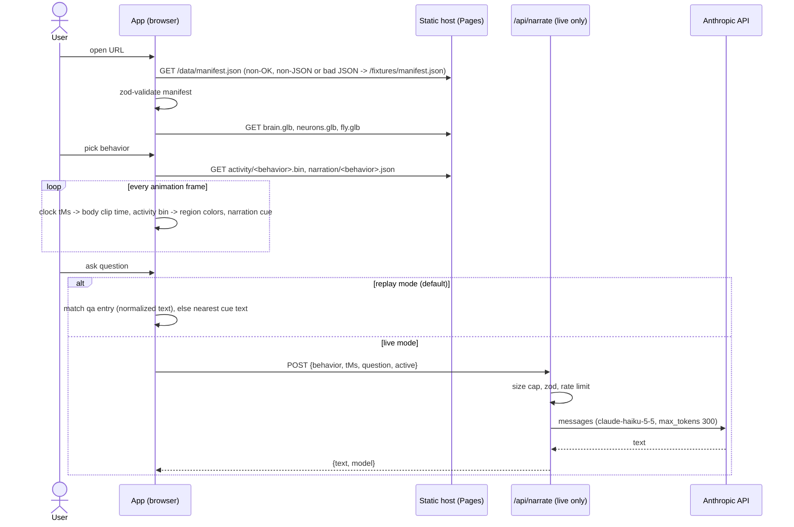
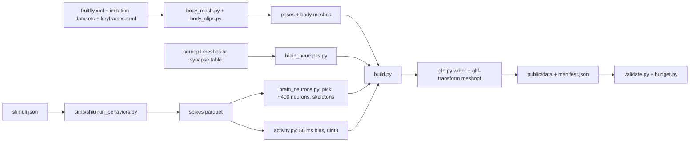

# PLAN-01 — Architecture

## 1. Components

| # | Component | Runs where | Inputs | Outputs |
|---|---|---|---|---|
| 1 | `pipeline/sims/shiu` (py3.10 uv project) | Offline, team machine ([HUMAN-05](HUMAN-05-real-data-pipeline-run.md)) | Shiu repo at pinned SHA, `stimuli.json`, FlyWire annotations TSV | `pipeline/data/raw/spikes/<behavior>.parquet` (t ms, trial, flywire_id) |
| 2 | `flybrain_pipeline` (py3.12 uv project) | Offline + CI (fixtures) | flybody `fruitfly.xml` + walking/flight imitation datasets, keyframes, spikes parquet, neuropil meshes or synapse table, neuron skeletons | `public/data/` (or `public/fixtures/`): `brain.glb`, `neurons.glb`, `fly.glb`, `activity/<behavior>.bin`, `manifest.json` |
| 3 | Contracts (`src/contracts/*.ts` → `schemas/*.schema.json`) | Build time | zod schemas | JSON Schemas used by Python `jsonschema` |
| 4 | Web app (Vite + React + r3f) | Browser, static on Cloudflare Pages | manifest, glb, bin, narration JSON | Brain view, body view, timeline, narration, Ask panel, attribution |
| 5 | `functions/api/narrate.ts` | Cloudflare Pages Function (live mode only) | Validated question + current top-active regions | One short narration answer |

No database, no auth, no object storage.

## 2. Data contracts

Source of truth: zod in `src/contracts/`. `npm run contracts` writes `schemas/<name>.schema.json` with `z.toJSONSchema` ([zod JSON Schema](https://zod.dev/json-schema)). Python validates every output with [`jsonschema`](https://pypi.org/project/jsonschema/). CI fails if `schemas/` drifts (`npm run contracts:check`).

```ts
// src/contracts/manifest.ts
export const BEHAVIORS = ['walking', 'grooming', 'feeding', 'escape'] as const;
export type BehaviorId = (typeof BEHAVIORS)[number];

export type ClipSource = 'reference-replay' | 'policy' | 'keyframed';

export interface Manifest {
  version: 1;
  dataSource: 'fixture' | 'flywire-783';
  brain: {
    neuropils: { url: string; kind: 'mesh' | 'points'; ids: string[] };   // glTF node names = neuropil ids, e.g. "GNG", "AMMC_L"
    neurons: { url: string; items: NeuronInfo[] };                         // glTF node names = flywire root ids
  };
  body: { url: string };                                                   // fly.glb, one animation per behavior, named by BehaviorId
  behaviors: BehaviorInfo[];
  attribution: { name: string; licence: string; url: string; citation: string }[];
}
export interface NeuronInfo { id: string; name: string; cellType: string; neuropil: string }
export interface BehaviorInfo {
  id: BehaviorId;
  label: string;
  durationMs: number;                       // body clip and activity share this length
  clipSource: ClipSource;
  activity: ActivityInfo;
  narrationUrl: string;
  stimulus: { description: string; cellTypes: string[]; assumption: boolean; source: string };
}
```

```ts
// src/contracts/activity.ts — describes activity/<behavior>.bin
export interface ActivityInfo {
  url: string;
  binMs: 50;
  nBins: number;                 // durationMs / binMs
  channels: string[];            // neuropil ids first, then neuron ids
  maxHz: number[];               // one per channel; value v in the bin => v / 255 * maxHz[c] Hz
  encoding: 'uint8-bin-major';   // byte index = bin * channels.length + channel
}
```

```ts
// src/contracts/narration.ts — public/narration/<behavior>.json
export interface NarrationScript {
  behavior: BehaviorId;
  cues: { tMs: number; text: string /* <= 280 chars */; focus: { neuropils: string[]; neurons: string[] } }[];
  qa: { q: string; a: string }[];     // replay answers for the Ask panel
}
```

```ts
// src/contracts/api.ts — POST /api/narrate (live mode)
export interface NarrateRequest {
  behavior: BehaviorId;
  tMs: number;                                  // integer, 0..60000
  question: string;                             // 1..280 chars, trimmed
  active: { id: string; hz: number }[];         // <= 10 items, id must match /^[A-Za-z0-9_]{1,20}$/
}
export type NarrateResponse = { text: string; model: string } | { error: string };
```

Body clip contract: `fly.glb` holds one node per MuJoCo body (flattened under a root node that converts MuJoCo Z-up to glTF Y-up). Each behavior is a glTF animation named by `BehaviorId` with translation + rotation channels per node, linear interpolation, 30 fps. No skinning.

## 2b. Raw data layout (`--raw`, default `pipeline/data/raw/`, gitignored)

Every producer writes here and `flybrain build --raw <dir>` reads only from here. The test raw dir `pipeline/tests/data/raw/` mirrors it with tiny files.

| Path under `raw/` | Written by | Content |
|---|---|---|
| `body/flybody/` | `flybrain fetch` (tarball, top-level dir stripped) | flybody repo at pinned SHA; MJCF at `body/flybody/flybody/fruitfly/assets/fruitfly.xml` |
| `body/walking/` | `flybrain fetch` | `walking-imitation-dataset` (build uses the first `*.hdf5` / `*.h5` in sorted order) |
| `body/flight/` | `flybrain fetch` | `flight-imitation-dataset` (same rule) |
| `brain/per_neuron_neuropil_count_post_783.feather` | `flybrain fetch` | Zenodo, CC BY 4.0 |
| `brain/proofread_root_ids_783.npy` | `flybrain fetch` | Zenodo, CC BY 4.0 |
| `brain/flywire_synapses_783.feather` | `flybrain fetch --with-synapses` | Optional, point-cloud mode only |
| `brain/annotations.tsv` | `flybrain fetch` | flywire_annotations `Supplemental_file1_neuron_annotations.tsv` at pinned commit |
| `spikes/<behavior>.parquet` | `pipeline/sims/shiu/run_behaviors.py` (default `--out`) | Shiu output: `t`, `trial`, `flywire_id`, `exp_name` |
| `brain/neuropils.npz` | `flybrain fetch-brain` | `{id: verts, faces}` (mesh mode) |
| `brain/skeletons.npz` | `flybrain fetch-brain` | `{root_id: nodes, edges}` for selected neurons |
| `brain/selected_neurons.json` | `flybrain fetch-brain` (every mode, including selection-only) | Sorted list of curated root ids (strings), from `select_neurons` |
| `config/keyframes.toml`, `config/stimuli.json` | optional override | Used instead of `pipeline/config/keyframes.toml` and `pipeline/sims/shiu/stimuli.json` when present (the test raw dir ships both) |

Outside `raw/`: Shiu code goes to `pipeline/sims/shiu/vendor/` (fetched, gitignored).

| Command | Flags |
|---|---|
| `flybrain fetch` | `--raw` (default `pipeline/data/raw`), `--only NAME`, `--with-synapses`, `--list` |
| `flybrain fetch-brain` | `--raw` (reads `spikes/`, `brain/*.feather`, `brain/annotations.tsv`; writes `brain/selected_neurons.json` always, plus `brain/neuropils.npz` and `brain/skeletons.npz` unless skipped), `--cap 400`, `--skip-neuropils` (point-cloud mode), `--skip-skeletons`. With both skip flags it is a token-free selection-only run: no FlyWire token, no `fetch` extra |
| `flybrain build` | `--raw`, `--out` (default `public/data`), `--fixture-raw`, `--points`, `--no-neuron-lines`, `--no-compress` |
| `run_behaviors.py` (shiu env) | `--behaviors`, `--n-proc` (default 4), `--out` (default `../../data/raw/spikes`), `--annotations`, `--vendor` |

## 3. Core loop sequence



Offline pipeline:



## 4. Repo tree

```
.
├── AGENT.md  CLAUDE.md  README.md  package.json  package-lock.json  vite.config.ts  tsconfig.json
├── eslint.config.js  .prettierrc.json  playwright.config.ts  wrangler.toml  index.html  .nvmrc
├── .github/workflows/{ci.yml,deploy.yml}
├── schemas/{manifest,activity,narration,api}.schema.json      # generated
├── scripts/emit-schemas.ts
├── functions/api/{narrate.ts,narrate.test.ts}
├── src/
│   ├── main.tsx  App.tsx  App.test.tsx  styles.css
│   ├── contracts/{manifest,activity,narration,api,index}.ts
│   ├── data/{loadManifest,activity,clock}.ts (+ .test.ts)
│   ├── narration/{replay,live}.ts (+ .test.ts)
│   ├── content/neuropils.ts
│   ├── scene/{BrainView,BodyView}.tsx  scene/{brainColors,clipTime}.ts (+ .test.ts)
│   └── components/{BehaviorPicker,Timeline,QualityToggle,NarrationPanel,AskPanel,AttributionPanel}.tsx (+ .test.tsx)
├── public/{_headers, 404.html, fixtures/**, data/**, narration/*.json}
├── e2e/demo.spec.ts
└── pipeline/
    ├── pyproject.toml  uv.lock  .python-version
    ├── config/keyframes.toml
    ├── src/flybrain_pipeline/{cli,validate,glb,activity,kinematics,budget,fixtures,fetch,body_mesh,body_clips,brain_neuropils,brain_neurons,build}.py
    ├── tests/ (+ tests/data/raw/ tiny inputs)
    └── sims/shiu/{pyproject.toml,uv.lock,.python-version,run_behaviors.py,stimuli.json,tests/}
```

## 5. Pinned stack

Versions checked 2026-10-14 on npm/PyPI ([RESEARCH-02](RESEARCH-02-stack-hosting.md)). "Pin at lock" means the exact version is written by `npm install --save-exact` / `uv lock` in WAVE-00 and was not pre-checked.

| Dep | Version | Why (one line) | Link |
|---|---|---|---|
| Node | 24 LTS | Current LTS; runs `.ts` scripts natively (no tsx) | https://nodejs.org/en/about/releases/ |
| vite | 8.3.4 | Static build + dev server | https://vite.dev |
| @vitejs/plugin-react | pin at lock | JSX/fast refresh for Vite | https://www.npmjs.com/package/@vitejs/plugin-react |
| react, react-dom | 19.3.1 | UI; required by r3f 9 | https://react.dev |
| three | 0.186.1 | WebGL renderer, GLTFLoader, MeshoptDecoder | https://threejs.org/docs/ |
| @react-three/fiber | 9.8.2 | Declarative three in React | https://r3f.docs.pmnd.rs |
| @react-three/drei | 10.7.9 | `useGLTF` (meshopt built in), `useAnimations`, `OrbitControls`, `Html` labels | https://drei.docs.pmnd.rs |
| zod | 4.6.7 | One schema for TS types, runtime checks and JSON Schema export | https://zod.dev |
| typescript | 7.0.2 | Types; fall back to latest 6.x if eslint/vite tooling rejects 7 (checked in WAVE-00) | https://registry.npmjs.org/typescript/latest |
| vitest + @vitest/coverage-v8 | 5.0.4 | Unit tests + 80% thresholds, shares Vite config | https://vitest.dev |
| jsdom, @testing-library/react | pin at lock | DOM for component tests | https://testing-library.com/docs/react-testing-library/intro |
| @playwright/test | 1.64.1 | E2E on the demo flow | https://playwright.dev |
| eslint (+ typescript-eslint, pin at lock), prettier | 10.12.0, 3.9.10 | Lint and format | https://eslint.org , https://prettier.io |
| @gltf-transform/cli | 4.5.1 | `optimize --compress meshopt` and `validate` for glb | https://gltf-transform.dev/cli |
| wrangler | 4.151.0 | Pages Function local dev + deploy | https://developers.cloudflare.com/workers/wrangler |
| Python | 3.12 | Main pipeline; 3.10 only in `sims/shiu` | https://www.python.org/downloads/ |
| uv | 0.13.1 | Envs, lockfiles, Python downloads | https://docs.astral.sh/uv/ |
| numpy / pandas / pyarrow | 2.5.4 / 3.0.6 / 26.0.0 | Arrays, spike tables, parquet | https://pypi.org/project/pandas/ |
| mujoco | 3.16.0 | Load `fruitfly.xml`, forward kinematics for poses | https://pypi.org/project/mujoco/ |
| h5py | pin at lock | Read flybody imitation datasets (HDF5) | https://pypi.org/project/h5py/ |
| fast-simplification | 0.2.0 | Decimate meshes to triangle budget | https://pypi.org/project/fast-simplification/ |
| jsonschema | pin at lock | Validate outputs against `schemas/` | https://pypi.org/project/jsonschema/ |
| fafbseg / navis (extra `fetch`) | 3.2.2 / 1.12.0 | Fetch FlyWire neuropils, meshes, skeletons; not installed in CI | https://fafbseg-py.readthedocs.io |
| pytest / pytest-cov / ruff | 9.1.1 / pin at lock / 0.17.0 | Tests, coverage gate, lint+format | https://pypi.org/project/pytest/ |
| Brian2 (sims/shiu only) | as pinned in Shiu `environment.yml` | Runs the Shiu LIF model unchanged | https://github.com/philshiu/Drosophila_brain_model |

Not used, on purpose: Anthropic SDK (one `fetch` call is enough), any LLM abstraction, state library (React `useSyncExternalStore`), Draco (meshopt covers meshes, lines and animations with one decoder bundled in three), MuJoCo WASM, flybody Python package and TensorFlow (we only need its MJCF, meshes and datasets).

LLM: Anthropic only. `NARRATION_MODEL` env, allowlist `claude-haiku-5-5` (default) or `claude-sonnet-5-5`. Tests use an injected fake `callModel`. Keyless demo uses replay JSON. No provider abstraction.

## 6. Asset budget

| Asset | Budget | Enforced by |
|---|---|---|
| Total first load (JS + CSS + manifest + 3 glb + 1 activity bin + 1 narration JSON), gzipped | ≤ 15 MB | `flybrain budget` |
| JS bundle (three + r3f + drei + app), gzipped | ≤ 600 KB | `flybrain budget` (reads `dist/assets/*.js`) |
| `brain.glb` neuropils | ≤ 150k triangles, ≤ 3 MB after meshopt | `flybrain budget` |
| `neurons.glb` curated neurons (~400) | ≤ 300k line segments, ≤ 5 MB after meshopt | `flybrain budget` |
| `fly.glb` body + 4 clips | ≤ 100k triangles, ≤ 3 MB | `flybrain budget` |
| `activity/<behavior>.bin` | ≤ 1 MB each (expected ≈ 40 KB: 80 bins × ~480 channels × 1 byte) | `flybrain budget` |
| `narration/<behavior>.json` | ≤ 20 KB each | `flybrain budget` |
| Any single file | < 25 MiB (Cloudflare Pages limit) | `flybrain budget` |
| File count | < 20,000 | `flybrain budget` |
| Frame rate | ≥ 30 fps mid laptop and recent phone; low quality = neuropils only, dpr 1 | release review, `?debug=1` |

## 7. Security

| Boundary | Control |
|---|---|
| `/api/narrate` input | Reject body > 2 KB; zod `NarrateRequest`; question trimmed, 1–280 chars; ids regex; behavior enum |
| Abuse | Cloudflare rate-limit binding `NARRATE_LIMITER`, 10 req/min per IP; in-memory per-isolate fallback if the binding is missing (Pages support for the binding is UNVERIFIED); `max_tokens: 300`; Anthropic spend cap |
| Secrets | `ANTHROPIC_API_KEY` only as Pages secret; never in `VITE_*`; missing key returns 503 `{error:"live mode unavailable"}` |
| Prompt injection | System prompt fixed server-side; user text sent as user content only; output length-capped and rendered as text, never HTML |
| Errors | Generic message to client, details to `console.error` (Workers logs) |
| Static site | `public/_headers`: CSP `default-src 'self'`, `script-src 'self' 'wasm-unsafe-eval'` (meshopt decoder), `frame-ancestors 'none'` |
| Fetched assets | zod-validate manifest; check activity byte length = nBins × channels |
