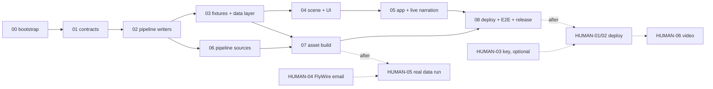

# PLAN-02 — Waves

Rules: tasks inside a wave are file-disjoint and run in parallel (one sonnet agent each). Dependency manifests and lockfiles are owned by WAVE-00 only. `.github/workflows/ci.yml` is owned by WAVE-00 (T00.3) and then WAVE-08 (T08.2) only. Every wave runs on committed fixtures; no wave lists a HUMAN prerequisite. Human steps gate only the real-data run, the live deploy and the video ([PLAN-00 §8](PLAN-00-overview.md)).

## Wave map

| Wave | Goal | Parallel tasks | Depends on | Gate command (short) | Est. h |
|---|---|---|---|---|---|
| [00](WAVE-00-bootstrap.md) | Repo, scaffold, CI, lint, test runners | T00.1 web scaffold · T00.2 pipeline scaffold · T00.3 git + CI | none | `npm run lint && npm test && npm run build && uv run --directory pipeline pytest` | 6 |
| [01](WAVE-01-contracts.md) | Shared contracts (zod → JSON Schema) + Python validator | T01.1 TS contracts + emit · T01.2 Python validator | 00 | `npm run contracts:check && npm test && uv run --directory pipeline pytest` | 6 |
| [02](WAVE-02-pipeline-writers.md) | Pure pipeline building blocks | T02.1 glb writer · T02.2 activity binning · T02.3 kinematics · T02.4 budget checker | 01 | `uv run --directory pipeline pytest && uv run --directory pipeline ruff check .` | 12 |
| [03](WAVE-03-fixtures-data-layer.md) | Fixture assets + web data layer + replay narration | T03.1 fixtures · T03.2 data layer · T03.3 replay provider · T03.4 narration content | 02 | `npm test && pytest && validate fixtures` | 14 |
| [04](WAVE-04-scene-and-ui-components.md) | 3D views and UI components | T04.1 BrainView · T04.2 BodyView · T04.3 controls + narration panel · T04.4 Ask + attribution + live client | 03 | `npm run lint && npm test && npm run build` | 18 |
| [05](WAVE-05-app-and-live-narration.md) | Wire the app; Pages Function | T05.1 App wiring · T05.2 `/api/narrate` | 04 | `npm run lint && npm test && npm run build` | 10 |
| [06](WAVE-06-pipeline-sources.md) | Source adapters (fixture-tested) | T06.1 body mesh · T06.2 body clips · T06.3 Shiu runner env · T06.4 neuropils · T06.5 neurons · T06.6 fetch | 02 | `uv run --directory pipeline pytest && uv run --directory pipeline/sims/shiu pytest` | 22 |
| [07](WAVE-07-asset-build.md) | One `flybrain build` command + cross-language asset check | T07.1 build + CLI · T07.2 TS asset contract test | 03, 06 | `flybrain build --source fixture ... && npm test` | 10 |
| [08](WAVE-08-deploy-e2e-release.md) | E2E on demo flow, CI/CD, headers, release review | T08.1 Playwright · T08.2 CI + deploy workflows · T08.3 security headers | 05, 07 | `npm run build && npm run e2e && full test + lint` | 12 |
| | | | | **Total** | **110** |

The loop runs waves in numeric order; the DAG shows which waves a team could run early by hand.

## Human steps (never on a code wave's critical path)

| Doc | Needed before | Fallback when not done |
|---|---|---|
| [HUMAN-01](HUMAN-01-github-repo.md) GitHub repo | first push / CI run | Run gates locally |
| [HUMAN-02](HUMAN-02-cloudflare-pages.md) Cloudflare Pages | hosted demo | `deploy.yml` skips with a notice; `npm run preview` locally |
| [HUMAN-03](HUMAN-03-anthropic-key.md) Anthropic key | live mode only | Replay mode (default) |
| [HUMAN-04](HUMAN-04-flywire-licence-email.md) FlyWire email | publishing real FlyWire meshes | Point clouds from CC BY synapse table |
| [HUMAN-05](HUMAN-05-real-data-pipeline-run.md) Real-data run | real assets in `public/data/` | App uses `public/fixtures/` with "fixture data" badge |
| [HUMAN-06](HUMAN-06-demo-video.md) Demo video | presentation | Live demo only |
